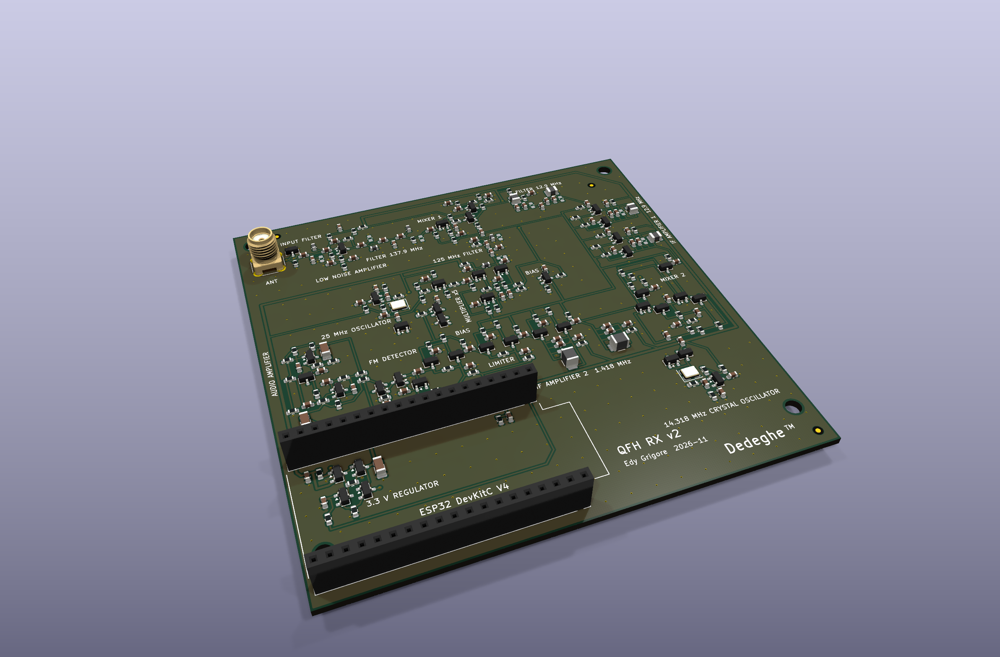
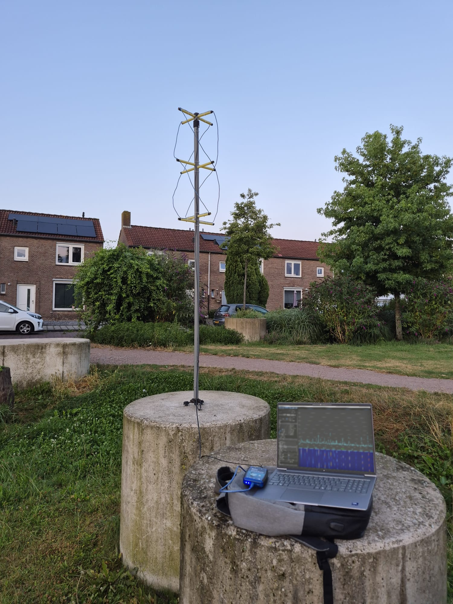
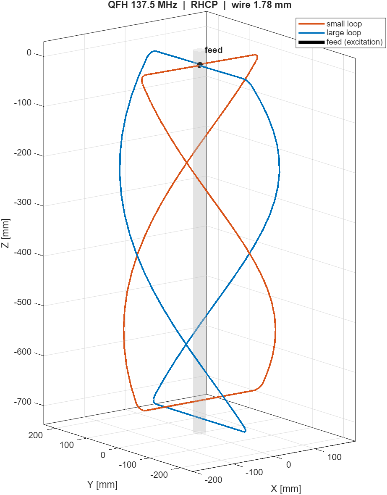
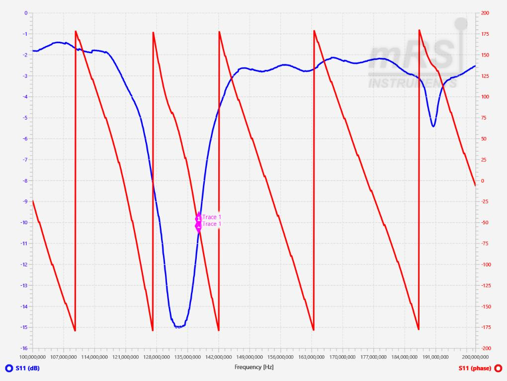
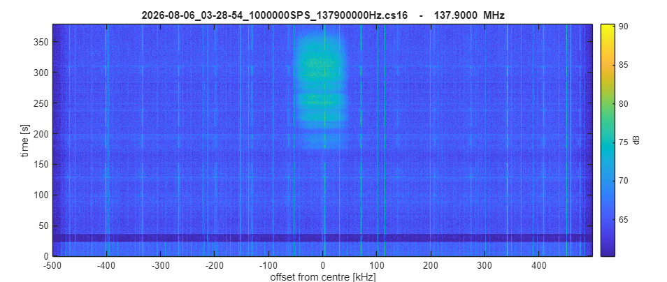
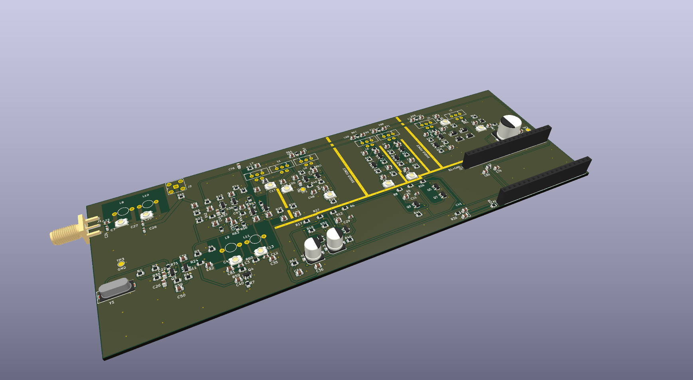
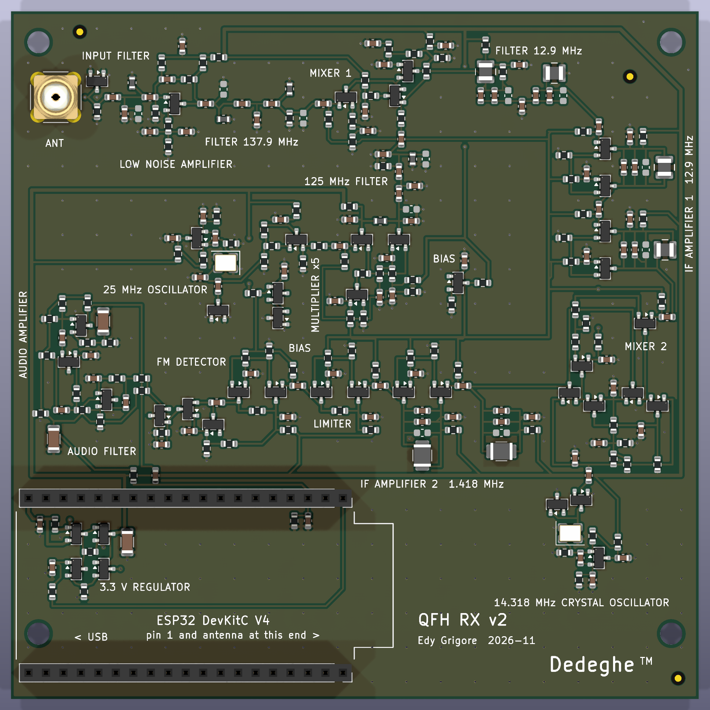
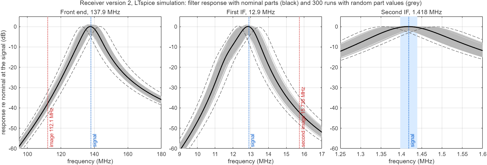

# QFH weather-satellite station: my own antenna and an all-discrete receiver

I'm Edy Grigore, an Electrical Engineering student at the University of
Twente. This is my personal project to receive weather satellites on 137 MHz
with hardware I designed myself: a QFH antenna and a radio receiver built only
from discrete parts (transistors, diodes, inductors and capacitors, no chips
in the signal path).

*Receiver version 2. This is a 3D picture that KiCad draws from the board file,
not a photo. The boards were ordered on 16 November 2026 and have not arrived
yet.*

Each section below starts with a short explanation that needs no radio
background. The numbers and the reasoning follow, with links to the detailed
pages. Words like "IF" or "image" are explained in
[Words used on this page](#words-used-on-this-page).

## Where the project stands (16 November 2026)

| Part | State |
|---|---|
| The antenna | designed with my own MATLAB tool, built and measured |
| Listening with a bought radio (SDR) | the Meteor-M satellite signal received and recognised; no picture decoded, because the signal was too weak |
| Receiver version 1 | designed, simulated and laid out; never ordered, because it was too expensive to have assembled |
| Receiver version 2 | designed, simulated block by block, laid out and checked. **Ordered on 16 November 2026: 5 boards, 2 of them assembled by JLCPCB. Not delivered yet, not tested, nothing measured** |

## Why I'm doing this

In my first year, the Module 4 project was to design an antenna and a
transmitter PCB. I really enjoyed that field, together with the High Frequency
Electronics, Electromagnetostatics and Electrodynamics courses, so I wanted to
go deeper: design my own antenna and my own receiver, and do the receiver fully
analog so I have to understand every stage at component level.

## How a weather picture reaches the ground

A weather satellite sends its pictures as a radio signal near 137 MHz. On the
ground the signal is extremely weak: around −90 to −100 dBm from my antenna,
which is less than a billionth of a milliwatt, or a few microvolts. The
receiver amplifies it to about a volt, filters out everything else, and turns
it into sound: a 2400 Hz tone whose loudness follows the brightness of the
picture, line by line. In my design an ESP32 microcontroller samples that
tone, and software on a PC turns it back into the picture (that firmware is
not written yet).

That is how the analog NOAA satellites worked (their "APT" signal). They were
switched off in 2025. The Meteor-M satellites that are still up send a digital
signal ("LRPT") that an analog FM receiver like mine cannot decode. So I test
the two halves separately: the antenna with a bought SDR on Meteor-M, and my
receiver on the bench, with a recorded NOAA pass played back into it by an
ADALM-Pluto SDR.

## The project in four parts

### 1. The antenna

A QFH (quadrifilar helix) antenna is two wire loops twisted around a mast. It
receives the circularly polarised signal of a satellite from almost anywhere
in the sky, so it does not need to be pointed. I wrote a MATLAB tool that
computes the antenna, exports it for simulation in NEC2, and prints a drilling
template for the mast. Then I built the antenna and measured it.

*Photo of my receiving setup in a park: the QFH antenna on its mast on a
concrete post, the ADALM-Pluto SDR (the blue box) and the laptop. The laptop
screen is edited in: it shows a SatDump screenshot from my own recording of
5 August 2026 (the spectrum and waterfall at 137.9 MHz). When the photo was
taken, the laptop showed a document.*

| The model (MATLAB) | The built antenna, measured |
|---|---|
|  |  |

*Left: the antenna as my MATLAB tool draws it (137.5 MHz, 1.78 mm wire).
Right: a measurement with a miniVNA Tiny (26 July 2026), S11 in dB in blue:
the best match is about −15 dB near 133 MHz and about −10 dB at 137.5 MHz.*

The built antenna resonates about 3 % lower than designed. For receiving, that
costs about 0.5 dB. **Deeper:** [`qfh_matlab/`](qfh_matlab) has the tool, the
4nec2 simulation next to this measurement, and why the plain design formulas
come out 2.2 % low in NEC2. The toolchain reproduces its reference program
exactly (all 127 NEC wire cards identical).

### 2. Listening with a bought SDR

Before building my own receiver, I recorded Meteor-M passes with the antenna
and an ADALM-Pluto. The signal is there (picture below), and SatDump's
decoder locked onto its error-correcting code, but no picture ever came out.

*Measurement: a real recording of Meteor-M N2-3 on 137.9 MHz, 6 August 2026,
shown by my `baseband_check.m`. Time runs upwards; the satellite's signal is
the band about 110 kHz wide in the middle.*

I first suspected the satellite. With help from the r/meteorsatellites
community I found the real cause: the mean signal-to-noise ratio was only
about 1.8 dB, below the 3 to 4 dB the decoder needs. The Pluto has no filter
and no low-noise amplifier at its input. **Deeper:**
[`lrpt_decoder/`](lrpt_decoder) (my own analysis chain, and the correction of
my first conclusion) and [`baseband_tools/`](baseband_tools) (tools that check
a recording before decoding it).

### 3. Receiver version 1: one conversion, coils wound by hand

The receiver is a superheterodyne. It mixes the 137.9 MHz signal with a
125 MHz signal made on the board, which shifts it down to 12.9 MHz (the
"intermediate frequency", IF). At 12.9 MHz it is much easier to amplify and
filter. Four amplifier stages give about 96 dB of gain there, a limiter cuts
the signal to a constant size, and a slope detector turns the frequency
changes into the 2400 Hz tone.

*Version 1, KiCad 3D picture (not a photo): 210 × 75 mm, 205 parts.*

I simulated every block in LTspice, then the whole receiver, and laid out the
board. It was checked many times. But building it needs 11 coils wound by hand
(7 on toroid cores, 4 air coils) and 11 trimmer capacitors that have to be
adjusted on the bench. JLCPCB quoted about €140 to assemble two boards. And
96 dB of gain at one frequency is easy to turn into an oscillator by
accident: the board had to grow to 210 mm with two shield fences across it.
I never ordered it.

**Deeper:** [`fm_receiver/`](fm_receiver) (the circuit and its 13
simulations) and [`pcb/`](pcb) (the board, every issue found and fixed).

### 4. Receiver version 2: two conversions, nothing to wind or tune

Version 2 does the same job, but it is designed for a factory. It has no coils
to wind and no trimmers to turn. JLCPCB places all 252 surface-mount parts by
machine and also solders the three connectors.

*Version 2 from above (KiCad 3D picture, not a photo): 100 × 100 mm. The
signal enters at the SMA jack at the top left, runs along the top edge, down
the right side, and back to the left through the second IF. The ESP32 DevKitC
plugs into the two socket rows at the bottom.*

Without trimmers, every tuned circuit has to be wide enough that normal part
tolerances cannot push it off the signal. At 12.9 MHz a filter that wide lets
through far too much noise. So version 2 converts the signal a second time,
from 12.9 MHz down to 1.418 MHz, where a filter of the right width (131 kHz)
is still tolerant enough. That second conversion is the central idea of
version 2. **Deeper:** [`fm_receiver_v2/`](fm_receiver_v2) and the board in
[`pcb_v2/`](pcb_v2).

## From version 1 to version 2

| | Version 1 | Version 2 |
|---|---|---|
| Conversions | one: 137.9 → 12.9 MHz | two: 137.9 → 12.9 → 1.418 MHz |
| Where the gain is | about 96 dB in one strip at 12.9 MHz | split between 12.9 MHz and 1.418 MHz |
| Coils | 11, wound by hand | 11 small SMD inductors, 3 values |
| Trimmers | 11, adjusted by hand | none |
| Oscillators | 25 MHz crystal × 5 = 125 MHz | the same, plus a 14.31818 MHz crystal |
| FM detector | slope detector (a tuned circuit) | charge-pump detector (no tuned circuit) |
| Supply | the ESP32 board's "5 V" pin (really about 4.6 V) | 3.3 V from a discrete regulator |
| Transistors | 20 | 38 |
| Parts | 205 | 252 surface-mount parts and 3 through-hole connectors |
| Board | 210 × 75 mm, 2 layers | 100 × 100 mm, 2 layers, all parts on the top |
| Assembly | by hand (JLCPCB quoted about €140 for 2 boards) | by JLCPCB: $39.99 (about €36) for 5 boards, 2 of them assembled |
| State | complete design, never ordered | ordered on 16 November 2026, not delivered yet |

The rule of the project stays the same: no ICs in the signal path. **Deeper:**
the reasons for each change are in
[`fm_receiver_v2/DESIGN_LOG.md`](fm_receiver_v2/DESIGN_LOG.md) ("Why a second
version" and "Frequency plan").

## Cost

**In short:** having two boards of version 1 assembled by JLCPCB was quoted at
about €140. Version 2 was ordered for $39.99 (about €36): five boards, two of
them assembled. The saving does not come from cheaper transistors. It comes
from designing the receiver around the way the factory charges.

| What | Price | Kind of figure | Source |
|---|---|---|---|
| Version 1, 2 boards assembled by JLCPCB (7 Nov 2026) | about €140 | JLCPCB quote | [`pcb/DESIGN_LOG.md`](pcb/DESIGN_LOG.md) |
| Version 2, first try with the wrong surface finish (OSP), 14 Nov | €143.52 for the assembly + €8.42 for the boards | JLCPCB quote | [`READ_ME_FIRST.txt`](pcb_v2/fabrication/READ_ME_FIRST.txt) |
| Version 2 without the connectors, my computation from JLCPCB's fee table, 14 Nov | $41.06 = €37.2 | computed | [`PARTS.md`](fm_receiver_v2/PARTS.md) |
| Version 2 in the cart, without the connectors: 5 boards, 2 assembled, HASL finish, 14 Nov | €3.62 + €30.37 = €33.99 | JLCPCB cart | [`COST.md`](fm_receiver_v2/COST.md) |
| **Version 2, ordered 16 Nov: 5 boards, 2 assembled with the connectors** | **$3.63 + $36.36 = $39.99 (about €36)** | **JLCPCB order list** | [`COST.md`](fm_receiver_v2/COST.md) |

All figures are without shipping, tax and the ESP32 board. The dollar figure is
about €36 at €1 = $1.1052.

Where the saving comes from:

1. **No coils to wind and no trimmers.** Every part comes from the factory's
   stock and is fitted there.
2. **The cheaper of JLCPCB's two assembly services ("Economic").** The dearer
   one ("Standard") charges for every different part type. A single part that
   JLCPCB marks "Standard only", or the wrong board finish, moves the whole
   order there. That is what happened to my first quote for version 2: the
   OSP finish made it €143.52 for the assembly alone. With the HASL finish the
   same files came to €30.37 in the cart.
3. **Parts from JLCPCB's fee-free lists.** 59 of the 63 part types are "Basic"
   or "Preferred" and carry no fee. Four are "Extended" at $3.07 each: the
   three inductor values and the 14.31818 MHz crystal.
4. **A small board** (100 × 100 mm, JLCPCB's cheapest size step) with every
   part on one side.

The three connectors (the SMA jack and the two socket rows) are through-hole
parts, which JLCPCB solders by hand for a fee. My computation said $12.70 more
for two boards, so at first I planned to solder them myself. The cart showed
about $6.60, so the order includes them.

**Deeper:** [`fm_receiver_v2/COST.md`](fm_receiver_v2/COST.md) has every
figure with its source, the price rules, and what did not get cheaper.

## What the version 2 simulations show

**In short:** before ordering anything, I simulated every block of version 2
in LTspice, then joined them up into the whole receiver, from the antenna to
the ESP32's pin. A simulation cannot prove that a board works, but it catches
mistakes that are cheap to fix on screen and expensive on a board. These are
the questions it answered. All of it is simulation: nothing of version 2 is
measured yet.

| Question | Simulated answer |
|---|---|
| Does each filter pass the satellite and block the "image" (a second frequency that would also come through the mixer)? | the first image (112.1 MHz) 38 dB down, the second (15.736 MHz) 42 dB down |
| Does it still work with normal part tolerances and nothing adjusted? | yes: in 300 runs with random part values, the narrow 1.418 MHz filter loses at most 2.1 dB, and the image stays at least 32 dB down (plot below). Only if every part is off in the same direction does the image come up to about 27 dB down |
| How weak a signal can it receive? | a clean picture from about −106 dBm, readable down to about −109 dBm |
| Does the level at the ESP32 depend on the signal strength? | no: the audio level stays the same from −121 dBm to −27 dBm at the input |
| Does a strong signal damage anything? | no: the Pluto at full power with no attenuator stays inside every limit of the input transistor |
| Do the crystal oscillators start, and are they gentle on the crystals? | yes, also with the worst crystal the data sheet allows; 56 to 75 µW into crystals rated for at most 200 µW |
| Can the strip of amplifiers oscillate by itself through stray coupling? | the simulations found how little coupling is too much (as little as 0.005 pF in one place); those limits became layout rules, and the strays computed from the finished copper are 70 to 3000 times smaller |
| Does the picture survive? | yes: a 2400 Hz tone with the picture in its loudness comes through with its depth only 1.4 % low |
| How much power? | the whole receiver draws 37 mA |

*Simulation (LTspice), not a measurement. The three filter sections of version
2: black with nominal parts, grey for 300 runs with random part values inside
their tolerance, dashed for all parts at the bottom or at the top of their
tolerance at once. Each curve is shown relative to the nominal response at the
signal. Made with
[`fm_receiver_v2/plots/plot_filter_tolerance.m`](fm_receiver_v2/plots/plot_filter_tolerance.m)
from the decks `rx2_a1`, `a2`, `d1`, `d2`, `f1` and `f3`.*

The simulations also caught several mistakes before any copper existed, for
example a simulator default that made a crystal oscillator look ten times
gentler than it is, and two bypass capacitors that resonated right in the
satellite band. **Deeper:** [`fm_receiver_v2/README.md`](fm_receiver_v2/README.md)
has the results block by block and "Things the simulation caught";
[`fm_receiver_v2/DESIGN_LOG.md`](fm_receiver_v2/DESIGN_LOG.md) has every number
with the test deck that produced it.

## What is checked, and what is not

- **Checked:** every block and the whole chain in simulation, including part
  tolerances, the supply range (3.0 to 3.6 V), a slow transistor model and the
  board's stray capacitances. The schematic is generated from the simulated
  circuit by a script, and a second script proves that both are the same
  circuit. The board passes KiCad's design-rule check.
- **Reviewed:** in four rounds (13 to 15 November 2026) by independent AI
  review agents. The first round found three risks in the circuit, and the
  second found a wrong rotation for the transistors in the factory's placement
  file; all were fixed. The last two rounds found no fault. JLCPCB's own
  placement preview of the final files without the connectors was checked as
  well: every transistor, diode and crystal sits the right way round on its
  pads.
- **Changed after the reviews:** four mounting holes, and the first 4 mm of
  the antenna track moved to the bottom side under the SMA jack. These were
  checked by script (rules check, a comparison with the reviewed board, the
  factory files read back), but no reviewer saw them. The same holds for the
  placement files with the three connectors, which the order uses: a script
  checks their places against JLCPCB's own footprints.
- **Simulated only:** every performance figure of version 2. Transistor
  models, inductor quality factors, crystal data and stray capacitances are
  estimates from data sheets and calculations.
- **Not done:** the boards have not arrived, so nothing of version 2 is tested
  or measured. No firmware is written. The final checks used no temperature corners.
- **The risks I expect on the bench:** an oscillation through stray coupling
  on the real copper; the 12.9 MHz filter landing too low if many parts are
  off the same way (in the worst case the checks found, the receiver would
  need about 30 dB more signal; with nominal parts it loses 1.7 dB), which is
  fixed by changing a few capacitors; and the start-up margin of the 25 MHz
  oscillator in the worst case (1.5 times). Each tuned circuit has a spare
  capacitor pad for corrections.

## What comes next

1. **When the boards arrive** (ordered on 16 November 2026): check that my
   ESP32 DevKitC fits the soldered sockets (the board assumes 25.40 mm between
   its two pin rows).
2. **Bring-up on the bench, one block at a time:** supply and stage currents,
   then the two oscillators, then a 137.9 MHz carrier from the Pluto, then an
   FM signal with a 2400 Hz tone, then a recorded satellite pass.
3. **Firmware for the ESP32:** sample the audio continuously (at least
   20,000 samples per second), send it to the PC, and decode the picture.
4. **On the reception side:** an LNA and a 137 MHz SAW filter in front of the
   SDR, then another try at Meteor-M.
5. **Later:** close the loop with my own hardware on both ends: a second QFH
   antenna and an FM transmitter on my own PCB, on a frequency I'm allowed to
   transmit on.

## What's in here

| Folder | What it is | State |
|---|---|---|
| [`qfh_matlab`](qfh_matlab) | MATLAB toolchain that designs the QFH antenna, exports it to NEC2 and prints a drilling template | antenna designed, simulated, built and measured |
| [`fm_receiver`](fm_receiver) | receiver version 1 and its LTspice simulations, block by block up to the full chain | simulated from RF input to the ADC |
| [`pcb`](pcb) | the KiCad board of version 1 | finished design, never ordered |
| [`fm_receiver_v2`](fm_receiver_v2) | receiver version 2: 11 circuit blocks, 32 test decks, the parts list and the cost | simulated from the antenna to the ADC |
| [`pcb_v2`](pcb_v2) | the KiCad schematic and board of version 2, generated by scripts, and the files for JLCPCB | ordered on 16 November 2026, not delivered yet |
| [`lrpt_decoder`](lrpt_decoder) | my own MATLAB analysis chain for Meteor-M LRPT recordings | working; taught me my signal was too weak |
| [`baseband_tools`](baseband_tools) | tools to check an SDR recording before decoding it | working |

## Tools

LTspice, KiCad 10 (with Python scripts and Freerouting), MATLAB R2025a,
4nec2 / NEC2, SatDump, an ADALM-Pluto SDR and a miniVNA Tiny.

## Words used on this page

- **dBm:** signal power compared with 1 milliwatt, in decibels. 0 dBm is
  1 mW, −30 dBm is 1 µW, −100 dBm is 0.1 picowatt. Every 10 dB is a factor of 10.
- **SDR (software-defined radio):** a receiver that turns the radio signal into
  numbers early and does the rest in software. I use an ADALM-Pluto.
- **Superheterodyne:** a receiver that first shifts the signal to a fixed, lower
  frequency, where it is easier to amplify and filter.
- **LO (local oscillator):** the signal made on the board that does that shift.
- **IF (intermediate frequency):** the lower frequency the signal is shifted
  to: 12.9 MHz in both versions, and 1.418 MHz as well in version 2.
- **Image:** a second input frequency that a mixer shifts to the same IF as
  the wanted one. A filter in front of the mixer has to block it.
- **Tuned circuit:** an inductor and a capacitor that together pass one
  frequency band. A **trimmer** is a capacitor that you adjust with a
  screwdriver to put that band in the right place.
- **Basic, Preferred, Extended:** JLCPCB's classes of parts. Extended parts
  cost an extra fee per part type.
- **Simulation, measurement, 3D picture:** every picture here says which one it
  is. A 3D picture is drawn by KiCad from the design files; it is not a photo.

## Credits and license

This is my project. I set the goals and made or approved every decision. I
used Claude (Anthropic) as an AI assistant along the way; each folder's README
says what it helped with. The antenna code is a MATLAB port of John Coppens'
online QFH calculator and of QFH2nec, both GPL-licensed, so `qfh_matlab` is
GPL-3.0. Everything else is MIT licensed (see [LICENSE](LICENSE)).

Edy Grigore
