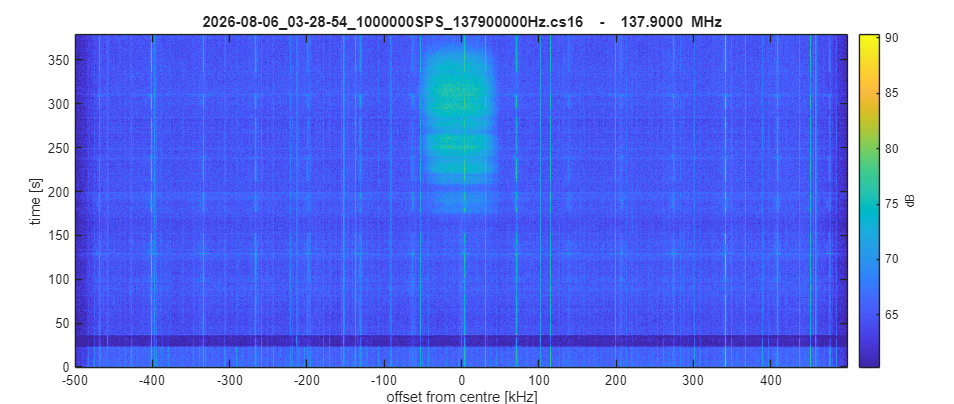

# baseband_tools — check the recording before you fight the decoder

Small base-MATLAB tools (no toolboxes) that came out of a hard lesson. When a
decoder says "no sync", it cannot tell you whether the signal is weak, the file
is broken, or the settings are wrong. These tools separate those cases in
minutes.

| Tool | What it does |
|------|--------------|
| `baseband_check.m` | health + signal check of a raw IQ recording (cs8/cs16/cf32): clipping, dead samples, quantisation vs dropout diagnosis, waterfall, in-band SNR vs time, Doppler signature |
| `signal_id.m` | identifies what a signal *is* without any decoder: occupied bandwidth, **symbol rate from the cyclostationary clock line** (|x|² spectrum), modulation hints from the x⁴ signature |
| `cut_segment.m` | cuts a time segment out of a recording for sharing (chunked, RAM-safe) |

*Measurement: the spectrogram that `baseband_check.m` draws, here for a real
recording of Meteor-M N2-3 on 137.9 MHz (6 August 2026, 03:28 UTC; QFH
antenna, no LNA, ADALM-Pluto at 1 MS/s, cs16). The LRPT signal is the band
about 110 kHz wide in the middle, visible for about two and a half minutes.
SatDump's Viterbi decoder locked on it, but no picture came out: the mean
signal-to-noise ratio was only about 1.8 dB (see
[`../lrpt_decoder`](../lrpt_decoder)).*

What I learned in the field and built into these tools: on a Pluto, record
cs16, never cs8 (12-bit ADC + weak satellite signal + cs8 = 1.5 effective bits
and a dead file). Never record into a cloud-synced folder. Run `baseband_check`
right after every pass, before any decoding.

## Attribution

I (Edy Grigore) developed these tools iteratively with **Claude (Anthropic)**
as a coding/DSP assistant. All recordings, measurements and field debugging are
my own.
