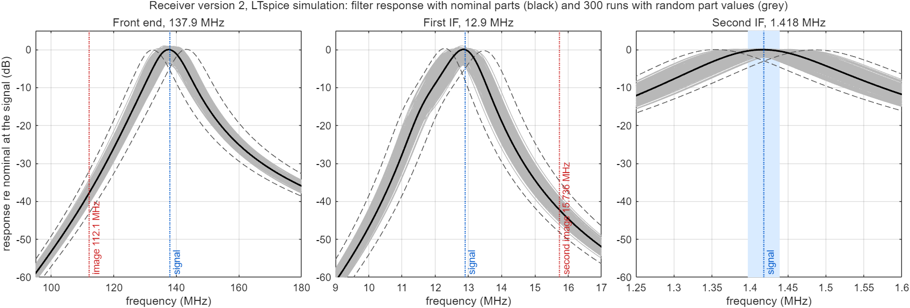

# Receiver version 2 (ordered, not tested yet)

A second version of my discrete 137.9 MHz FM receiver. Version 1 is in
[`../fm_receiver`](../fm_receiver), with its board in [`../pcb`](../pcb).

**Status (2026-11-16): every block is designed and simulated in LTspice, from
the antenna to the ESP32's ADC, including the supply. The schematic and the
board are done, and the boards were ordered from JLCPCB on 2026-11-16: 5
boards, 2 of them assembled, with the connectors. They have not arrived yet;
nothing is tested or measured.** An independent check of the simulations found
three risks, and the circuit was changed for each of them (bias reference, a
possible GHz oscillation, stray feedback in the IF strips). The parts list has
252 parts, each with its JLCPCB number ([`PARTS.md`](PARTS.md)). The order came
to $39.99 in JLCPCB's order list, without shipping and tax
([`COST.md`](COST.md)). The schematic and the board are in
[`../pcb_v2`](../pcb_v2); two later rounds of review found no fault there.

## Why

Version 1's board needs 11 hand-wound coils and 11 trimmers, and it puts
96 dB of gain at one frequency. JLCPCB quoted about €140 to assemble two
boards. Version 2 has a different target: JLCPCB assembles it completely for
less than €50 (5 boards, 2 assembled), with no coils to wind and nothing to
tune. The rule from version 1 stays: no ICs in the signal path. The order
came to $39.99 (about €36); how the cost came down, with the source of every
figure, is in [`COST.md`](COST.md).

## The test it is built for

The NOAA satellites that sent this signal are switched off. So the test is on
the bench: my ADALM-Pluto replays a recorded NOAA pass at 137.9 MHz, through
attenuators and a cable, into the receiver. The ESP32 samples the audio and
software turns it into the picture. If I can read the picture, the receiver
works. The simulations below are chosen for that test: signal levels from
strong to very weak, and how well the picture content (the amplitude of the
2400 Hz tone) comes through.

## How it differs

| | Version 1 | Version 2 |
|---|---|---|
| Conversions | one: 137.9 → 12.9 MHz | two: 137.9 → 12.9 → 1.418 MHz |
| Coils | 11, wound by hand | 11 small SMD inductors |
| Trimmers | 11 | none |
| Gain | 96 dB at 12.9 MHz | split over three frequencies |
| FM detector | slope detector | charge-pump detector (no tuned circuit) |
| Oscillator level | set by the transistor | set by a diode clamp |
| Supply | 4.6 V straight from the DevKitC | 3.3 V from a discrete regulator |

```
antenna -> tuned circuit -> LNA -> 2 tuned circuits -> mixer 1 <- 125 MHz
                                                                  (25 MHz crystal -> follower -> squarer x 5 -> 2 tuned circuits)
        -> first IF, 12.9 MHz: 4 tuned circuits, 2 emitter-coupled pairs
        -> mixer 2 <- 14.31818 MHz crystal oscillator
        -> second IF, 1.418 MHz: 2 tuned circuits, 1 tuned pair, 1 limiter pair
        -> pump-driver pair -> charge-pump detector
        -> audio: buffer, 4th-order low-pass, gain -> ESP32 ADC
supply: DevKitC 5V pin -> discrete regulator (reference: the DevKitC's 3V3 pin) -> 3.3 V rail
```

Without trimmers a tuned circuit has to be wide, so that ±5 % parts cannot
move it off the signal. At 12.9 MHz "wide" is over 1 MHz. At 1.418 MHz it is
about 130 kHz. That is why there is a second conversion.

## What the simulation shows

All of this is simulation. Nothing of version 2 is built or measured yet.

| Block | Result | Decks (`simulations/rx2_…`) |
|---|---|---|
| Front end (LNA, three tuned circuits) | +19 dB from the antenna to the first mixer (counted from the voltage a matched antenna delivers; 13.3 dB from the source's open-circuit voltage); image 38 dB down, at least 32 dB in 300 tolerance runs, 26.6 dB in the one corner where every part is off the same way; noise figure 4.7 dB | `a1`, `a2`, `a3` |
| 125 MHz chain | 0.36 V at the mixer (0.28 to 0.39 V with part tolerances, 0.31 to 0.42 V for a 3.0 to 3.6 V rail); unwanted 100 and 150 MHz 52 and 49 dB down; with mismatched transistors 150 MHz is typically 43 dB down, 32 dB at worst | `b1` to `b4` |
| First mixer and first IF, 12.9 MHz | 48 dB; second image down 42 dB, at least 36 dB in 300 tolerance runs | `c1`, `d1`, `d2` |
| Second mixer and oscillator | double-balanced, 19 dB; oscillator leak at the IF 1.8 mV (30 mV with a single-balanced mixer); crystal drive 58 to 67 µW with the real mixer as its load | `e1`, `e2` |
| Second IF, 1.418 MHz | 131 kHz wide; ±5 % parts cost at most 2.1 dB, 3.0 dB if all are off the same way | `f1`, `f2`, `f3` |
| Charge-pump detector | 10 mV peak of audio for ±17 kHz, 0.3 % distortion; from −10 to 60 °C its DC level stays within ±1 % and its audio level within about ±3 % | `g1`, `o1` |
| Audio chain | 0.49 V peak-to-peak at the ADC; flat within ±0.3 dB from 320 to 4480 Hz; 69 dB down where the ADC would alias | `i1`, `i2` |
| Supply | 3.31 V; ripple from the USB side 77 dB down at 2400 Hz; the whole receiver draws 37 mA | `j1`, `j2`, `k1` |
| Whole receiver with FM, antenna to detector | the same audio level (10.2 to 10.9 mV peak) from −121 dBm to −27 dBm at the input, so the attenuator setting does not change the picture's brightness; with the receiver's own noise the picture is estimated to be clean from about −106 dBm and readable down to about −109 dBm (noise figure about 6.5 dB with the first mixer and the first IF, calculated); an earlier figure, without the noise of the first mixer and the first IF, was −112 dBm | `h1`, `h2`, `l2` |
| Unwanted responses, antenna to second mixer | image −37 dB; the other satellite channel (137.1 MHz) −55 dB, about −38 dB with the worst transistor mismatch; everything else below −65 dB at a 100 µV input (the response at half the IF rises to −58 dB at 1 mV) | `l1` |
| Picture test | an amplitude-modulated 2400 Hz tone comes through with its depth 1.4 % low, up to the finest detail | `h3` |
| Stray feedback | each IF strip was tested with stray coupling from its output back to its input, and the second IF locking itself through the first; the thresholds set the layout rules for the board | `m1`, `p1`, `p2`, `q1` |
| Too much signal | the Pluto at full power with no attenuator stays inside every limit of the input transistor | `n1` |

Every number, with the test decks that produced it, is in
[`DESIGN_LOG.md`](DESIGN_LOG.md). Where an early section of the log and a
later one disagree, the later one counts.



*Simulation (LTspice), not a measurement. The three filter sections: black
with nominal parts, grey for 300 runs with random part values inside their
tolerance (inductors ±2 % and capacitors ±5 % or ±0.25 pF in the front end;
every tuned-circuit part ±5 % in the IF strips), dashed for all parts at the
bottom or at the top of their tolerance at once. Each curve is relative to the
nominal response at the signal frequency. The plot comes from decks `a1`, `a2`,
`d1`, `d2`, `f1` and `f3`, run unchanged except for one added `.save` line, and
drawn by [`plots/plot_filter_tolerance.m`](plots/plot_filter_tolerance.m),
whose header says how to run it again.*

What the plot shows: the 137.9 MHz and 12.9 MHz filters are wide and their
skirts still block the images; the 1.418 MHz filter is the narrow one, and
even there random part values cost at most 2.1 dB at the signal. The
dashed curves of the 12.9 MHz filter show the weak spot: if every part is 5 %
high, that filter loses 8 dB at the signal. On the board the strays pull it
lower still. If that happens on the bench, smaller capacitors (`Ct1b` to
`Ct4b`) raise it again (design log, "Reviews before the order").

## Things the simulation caught

- **A simulator trap.** LTspice quietly damps every inductor in a time-domain
  run. That made a crystal oscillator look tame (39 µW) when the real circuit
  would have driven its crystal at about 480 µW. Both oscillators now take
  their output behind the crystal and are clamped by diodes.
- **A dirty oscillator output makes the wrong harmonics.** The × 5 stage only
  makes odd harmonics if its drive is a clean sine. With 7.5 % of second
  harmonic in the drive it also made 150 MHz, which would let the other
  satellite channel in.
- **Two bypass capacitors can resonate in the band.** A 1 nF and a 100 nF in
  parallel, each with its via, resonate near 135 MHz. This put a 5 dB dip in
  the front end until the bypassing was changed.
- **An emitter follower is not a perfect buffer.** Its gain of 0.91 turned a
  sharp filter section into a dull one. The audio filter now uses two equal,
  gentler sections.
- **A single-balanced mixer leaks its oscillator.** At the second mixer the
  leak was stronger than a weak signal, so that mixer is double-balanced.
- **A fault that was hiding another one.** All stage currents hung on two
  diodes. Replacing them with a steadier reference made the detector drift
  with temperature: the diodes' drift had been cancelling the charge pump's.
  The pump driver now has its own reference that follows the pump.
- **Feedback measured in femtofarads.** The 1.418 MHz strip has 73 dB of
  gain; 0.005 pF from its output back to its input makes it oscillate. That
  is now a layout rule, with the distance it needs.

## Files

| File | What it is |
|---|---|
| [`DESIGN_LOG.md`](DESIGN_LOG.md) | the step-by-step record, with every number |
| [`PARTS.md`](PARTS.md) | the parts list: every part with its JLCPCB number and fee class, and the computed cost sheet |
| [`COST.md`](COST.md) | the cost of version 1 and version 2: every figure with its source, JLCPCB's price rules, and where the saving comes from |
| [`rx2_parts.csv`](rx2_parts.csv) | the same list for programs, one row per part |
| [`plots/`](plots) | the filter plot above and the MATLAB script that draws it from the simulator's output |
| [`../pcb_v2/`](../pcb_v2) | the schematic and the board (KiCad 10), both built by scripts from the circuit blocks; the schematic is compared with the blocks by script, the board passes the design rules check |
| `simulations/rx2_blk_*.inc` | the circuit blocks, one file per block |
| `simulations/rx2_*.cir` | the test decks (open in LTspice and press Run) |
| `simulations/models.lib`, `models_slow.lib` | transistor, diode and crystal models, nominal and slow corner |

## Attribution

I set the goal for version 2 and approved the plan. The architecture, the
simulations, the schematic and the board (with the scripts in
[`../pcb_v2/gen`](../pcb_v2/gen)) are worked out with Claude (Anthropic) as an
AI assistant, and I review each step.

Edy Grigore
