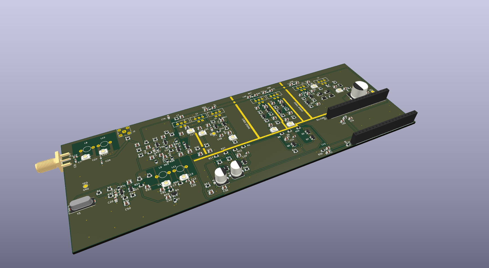
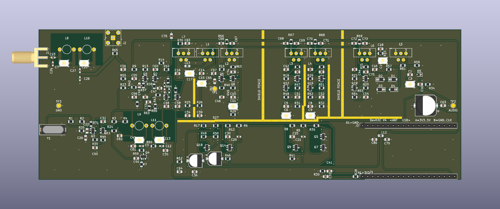
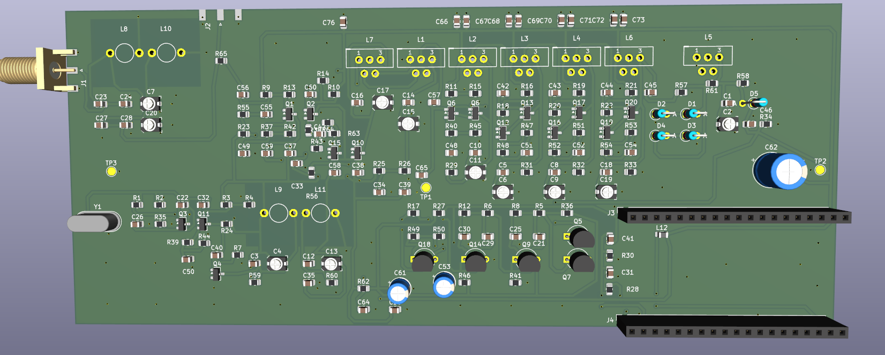

# PCB — discrete 137.9 MHz FM satellite receiver

This is the circuit board for the receiver I simulated in
[`../fm_receiver`](../fm_receiver). The board is built from that simulation:
its schematic was generated from the full-receiver netlist `sim12`, and if the
board and that netlist ever disagree, the netlist wins.

> **Status (November 2026): finished as a design, never ordered or built.**
> The last copper change was on 7 November 2026, and a final check on
> 10 November found nothing that stops the board from working. I did not
> order it: having two boards assembled was quoted at about €140, and by hand
> it means winding 11 coils and aligning 11 trimmers. Its successor,
> [version 2](../pcb_v2), is designed so that JLCPCB can assemble all of it; it
> was ordered on 16 November 2026.
> The comparison is in [the main README](../README.md#from-version-1-to-version-2).



*3D picture of the version 1 board, made by KiCad from the board file (not a photo).*

## The board at a glance

| | |
|---|---|
| Size | 210 × 75 mm, 2 layers, FR4 1.6 mm |
| Parts | 205, all on the top side, all SMD except the 11 hand-wound coils, the antenna SMA, the test SMA and the two ESP32 socket strips |
| Assembly | planned by hand: bare boards from JLCPCB, parts from LCSC (JLC assembly was quoted at about €140 for two boards). Not ordered |
| Bottom layer | one ground plane |
| Controller | ESP32-DevKitC V4 on a socket (its ADC digitizes the audio) |
| Supply | the DevKitC's 5V pin (really about 4.6 V), about 41 mA |
| Checks | KiCad DRC clean at a 0.254 mm clearance floor; schematic and board match pad for pad |



*The final version 1 board from above (KiCad 3D picture). The two yellow strips
across the IF strip are the exposed ground lands for the shield fences.*



*The same board on 13 September 2026 (KiCad 3D picture), before the
through-hole transistors, trimmers and capacitors were swapped for SMD
versions so that a factory could place them. The board was 180 mm long then.*

## Floorplan

```
+----------------------------------------------------------------------------------+
| [SMA ant] BPF (2 air coils, | LNA | MIXER | == IF STRIP, 96 dB, straight ======= |
|  plane cutouts) [SMA test]  | SMD | +L7   |  L1 [1] #F1# [2][3] #F2# [4] lim DET |
|-------- via wall ------------------------------------------------------ via wall|
| LO CHAIN: xtal 25MHz | buffer | x5 (2 air coils) -> up into mixer LO port        |
|                      AUDIO chain (2400 Hz, folds freely) <- from detector        |
|                                   supply filter   ESP32 socket [USB over edge] > |
+----------------------------------------------------------------------------------+
#F1#, #F2# = shield fences: exposed ground strips for 15 mm tin-plate walls
L7, L1 = the two toroid tanks of the IF filter; [1]-[4] = the four IF stages
```

The 4.6 V supply comes in from the ESP32 socket at the right-hand end and is
filtered there before it runs left along the board.

The weakest signals (microvolts) start at the left edge and the strongest
(volts) end at the right. The IF strip runs in a straight line with its input
and output at opposite ends, because with 96 dB of gain even a little coupling
from the output back to the input would make it oscillate.

## Layout rules I followed

- **The bottom layer is ground.** Everything is routed on top, except where a
  trace had to cross another: 27 bottom-layer segments, 171 mm in total on 12
  nets. The longest are two `vb2` bias runs (25 and 16 mm) under the IF strip.
  They carry DC and are bypassed at both ends. Each hop is listed and
  justified in the design log.
- **Shielding provisions for free.** Rows of ground vias between the IF stages
  and between the RF and the LO/audio sections, with exposed ground strips so a
  brass shield can be soldered on later if the strip oscillates.
- **Two shield fences across the toroid row.** A stability study (below)
  showed that the real risk is the toroids themselves, which stand on edge in
  one open row. So the board was made 30 mm longer: a 20 mm gap between
  stage 1 and stage 2 and a 10 mm gap between stage 3 and stage 4. Each gap
  has an exposed ground strip with 15 stitching vias, from the top edge down
  to the via wall. A 15 mm tall tin-plate fence soldered onto each one
  separates three groups:
  - the IF filter and stage 1;
  - stages 2–3;
  - stage 4, the limiter and the detector.

  The strongest sources of feedback (stage 4 and the detector) now have to get
  past two fences to reach the IF filter.
- **Tight RF loops.** Every tuned circuit's parts sit right at its coil, and the
  LNA's emitter bypass is within about 5 mm of copper of the transistor. At VHF
  a few nanohenries of track change the tuning and the gain.
- **A real 50 ohm antenna input.** The SMA feeds the filter through a 1.5 mm
  coplanar line with ground on both sides.
- **Decoupling everywhere.** Every IF stage has its own 100 nF capacitors on its
  supply and on its cascode bias, fed through its own 47 ohm resistor, so the
  stages cannot talk to each other through the supply. The mixer tank L7 has
  its own 10 ohm + 100 nF feed for the same reason.
- **Test points for bring-up.** A second SMA (J2) with a 0 ohm link R65 at the
  filter→LNA seam (remove R65 and J1→J2 is the band-pass filter alone, ready
  for a VNA), an injection pad TP1 at the first IF stage, and a monitor pad
  TP2 on the audio.
- **No parts on the back and no mounting holes**, both on purpose.

The toroids (T37-6, 27 turns) and the air coils (5 mm diameter) use my own
footprints in `qfh_receiver.pretty`. The air-coil footprint keeps copper away
from under the coil, because a ground plane there would kill its Q.

**Winding rule for the toroids: return-wind them.** A winding that advances once
around the core also behaves like one big single turn, and that turn leaks a
magnetic field (the "one-turn effect"). After the last turn, lay the wire back
around the outside of the core to where the winding started, and only then go
to the pin. That cancels most of the leak. It is required on L4, L6 and L5 (the
high-level end of the strip) and costs nothing on the others, so I do it on all
seven.

**Winding rule for the two link windings (L7 and L1): put the 2 turns at the
cold end**, next to pad 1, and ground the link loop with a short wire from L1
pad 5 to L1 pad 1 (about 5 mm). The loop is otherwise floating, and a link
wound over the hot end of a tank has 0.5–1 pF to it. Through the loop that is
0.25–0.5 pF from one tank to the other, next to the 0.77 pF (0.011 × 70 pF)
that the whole designed coupling amounts to. At the cold end and grounded,
that stray path is gone and L13 alone sets the coupling.

**Winding rule for the air coils (L8–L11): spread the turns to a set length.**
Wind them from 0.8 mm wire on a 5 mm former, then pull the turns apart evenly.
The length sets the inductance (Wheeler's formula, good to about ±10 %; a coil
also springs open a little when it comes off the former):

| Coil | Turns | Length | Inductance |
|---|---|---|---|
| L8, L10 (band-pass filter) | 5 | about 7 mm | about 86 nH (82 nH at 7.5 mm) |
| L9, L11 (×5 and LO tanks) | 7 | about 8.2 mm | about 150 nH |

Wound tight, turn against turn, they would be about 120 nH and 190 nH, which
is more than the 4 pF trimmers can pull in. The band-pass coils are a little
short on purpose. Their trimmers are expected near 5 pF of 6 pF: in the
simulation with the board's parasitics, a coil 10 % low needs 6.6 pF, which
the trimmer does not have, and a coil 10 % high needs 4.0 pF, the middle of
its range. At 7 mm the legs also drop straight into the pads.

## How I checked it

KiCad's design-rule check is clean at a 0.254 mm clearance floor. The
schematic was generated from the simulation netlist and compared with the board
pad by pad (436 connections, no differences; the 33 unused ESP32 pins carry
no-connect flags). Every part has a stocked LCSC part number for JLCPCB
assembly. I also had the board reviewed by independent AI review passes, which
is how several of the issues below were found. The last full one, on
6 November 2026, re-ran the simulations against the board as built and checked
it from seven angles (simulation, schematic, RF layout, IF stability, power,
manufacturing, requirements). A final read-only check on 10 November moved no
copper and found nothing that stops the board from working.

## Issues found and fixed

- **Two TO-92 transistor types had base and emitter swapped** because a
  generic symbol used the wrong pin order. Lesson: check each footprint's pinout
  against the datasheet, not against the symbol library.
- **The ESP32 socket would not have powered anything.** The 5 V feed landed on
  a GPIO pin and the enable pin was grounded. I fixed it after checking the
  DevKitC pinout from several sources and every way the module could be
  plugged in.
- **The "5 V" supply is really 4.6 V**, because the DevKitC puts a Schottky
  diode after USB. I re-centred every bias divider in the simulation for 4.6 V
  instead of accepting lower gain.
- **Some specified trimmers did not exist as real parts.** Together with the
  board's own parasitics this pushed three tuned circuits to the end of their
  trimmer range. I re-split the fixed capacitor and the trimmer in each one so
  the trimmer now lands mid-range.
- **The LNA's emitter bypass capacitor was 20 mm from the transistor.** That
  is about 12 nH, which would have cost 4–5 dB of gain. It is now within 5 mm.
- **The IF strip would probably have oscillated.** From the IF filter to the
  last stage there is about 124 dB of gain. In LTspice, a stray coupling of only
  0.045 fF from the last stage back into the IF filter, or a mutual inductance
  of 1.4 pH between two toroids, is enough to make it oscillate. My estimates
  from the board geometry put the toroid-to-toroid coupling at 1–7 times that.
  The supply decoupling and the PCB traces were fine. The fixes are two fences,
  30 mm of extra distance and the return-wound toroids, with the damping
  resistors as a gain knob on the bench. The details are in the design log.
- **Through-hole parts swapped for SMD versions of the same parts** so the board
  can be machine-assembled: the five audio transistors (now MMBT3904/3906 in
  SOT-23), the five diodes, the crystal and the three electrolytics. SOT-23 has
  a different pin order from TO-92 (B-E-C instead of E-B-C), so the schematic
  symbols changed too. I checked afterwards that every pad still carries the
  same net as before.
- **The full check of 6 November 2026 found six more board problems**, all
  fixed:
  - *The IF filter was over-coupled.* Its two toroids are joined by a link
    winding, and the old rule of thumb for the link (k ≈ (n/N)²) is wrong for a
    low-impedance loop. The real coupling would have been 0.08–0.3 instead of
    0.011. That gives one narrow peak, weak skirts and a spurious passband a few
    MHz higher. Fix: 2-turn links plus a 680 nH inductor (L13) in series in the
    link loop. The simulation gives 209 kHz, single-peaked, −24 dB at ±500 kHz.
  - *The mixer tank L7 shared the supply trunk* with only one capacitor, which
    gave the IF strip a feedback path through the supply (loop gain up to
    about 1). It now has its own 10 Ω + 100 nF feed, and the four stage feed
    resistors went from 10 to 47 Ω. That path is now below 0.002.
  - *The crystal oscillator could oscillate at UHF* (0.7–0.8 GHz in the
    simulation) because its two feedback capacitors sat 14 mm away. They now sit
    on the transistor's pads, with their own ground via and a 33 Ω base stopper.
    Their values changed to 22 pF and 180 pF so the crystal sees its rated 20 pF
    load. The old values loaded it with about 55 pF, which pulled the LO 30 kHz
    low.
  - *The LNA input was mismatched* (about 20 Ω, VSWR 2.5), because on the board
    the LNA drives the mixer's base, not 50 Ω. That cost 4–6 dB of image
    rejection. A 56 Ω resistor at the LNA output brings the VSWR down to about 1.2
    and the image rejection back to about 38 dB. It costs 5 dB of gain, and the
    receiver has 11 dB to spare.
  - *The IF trimmers would have ended up at their minimum* once the board's own
    capacitance was counted. The fixed tank capacitors went from 56 to 47 pF.
  - *The mixer transistor pair could oscillate at 1–2 GHz* in the simulation
    (low confidence, because the transistor model is generic up there; but
    the fix is cheap). Fix: a 100 Ω base stopper R73 on Q10, a 47 Ω + 1 nF
    snubber (R74, C84) at Q15's base and a 100 Ω collector resistor R75 on
    Q15. The mixer is then clean across ±50 % of the estimated layout
    inductance, with the LO running.
  Smaller fixes from the same check: one trimmer turned round so its rotor
  sits on the cold side, and silkscreen raised to JLCPCB's minimum line width.

  A last simulation of the fixed board gives:
  - crystal oscillator: clean start-up, LO within 5 kHz;
  - LNA input VSWR: 1.18;
  - image rejection: 38.3 dB;
  - IF filter: 218 kHz;
  - audio at the ADC: 0.44 Vpp at 1.8 % distortion.

  After the cost-down of 7 November (cheaper parts, see "Ordering"), the same
  simulation gives 37.7 dB of image rejection, a 221 kHz IF filter, and
  0.50 Vpp at 1.5 % distortion at the ADC.

## Bring-up plan

1. **Power only.** Check every DC voltage against the `sim12` operating
   point. Total current is about 41 mA from the DevKitC's 4.6 V. The values
   to expect (from the `sim12` operating point at 4.6 V; the oscillator
   values are for a stopped oscillator and move a little when it runs):

   | Node | Expected |
   |---|---|
   | LNA Q1 emitter / collector | 0.98 V / 2.25 V (19.6 mA, half of the total) |
   | IF stages, lower emitter (Q6, Q12, Q16, Q19) | 0.52 V (1.0 mA each) |
   | `vb2` (cascode bias) | 2.58 V |
   | IF stages, lower collector (`c1a`–`c4a`) | 1.87 V |
   | Mixer Q2 emitter / `e23` / `vb2n` | 0.49 V / 1.64 V / 2.36 V |
   | Oscillator Q3 base / emitter | 2.28 V / 1.54 V |
   | Buffer Q11 collector | 3.08 V |
   | Audio: `vaud` / Q18 collector | 4.47 V / 2.90 V |
   | ADC pin | 1.26 V |
2. **Local oscillator.** Measure the crystal oscillator's exact frequency
   f_X (about 25.000 MHz) with a counter or the Pluto. Then check 5 × f_X
   (about 125 MHz) at the mixer. The IF is then **f_IF = 137.9 MHz − 5 × f_X**.
   Use this number in every step below, not 12.9 MHz exactly.
3. **Band-pass filter.** Remove the 0 Ω link R65. J1 → J2 is then the
   band-pass filter on its own: sweep it on the VNA and set the trimmers C7
   and C20. Expect about 2 dB of loss at 137.9 MHz and about 39 dB of image
   rejection at 112.1 MHz. Refit R65. The LNA cannot be measured on its own,
   because its load is the mixer, not 50 Ω.
4. **IF strip, no signal first.** The limiter output should show only noise. A
   steady tone means the strip oscillates. If it oscillates even with both
   fences fitted, lower two of the damping resistors Rd1–Rd4 (10 kΩ → 4.7 kΩ,
   about −10 dB of loop gain). R66–R69 can also go up from 47 to 100 Ω.
   - Do not put a scope probe on a collector or on the limiter output. Its
     12 pF on a 68.7 pF tank pulls the stage about 1.1 MHz low, which is five
     times the filter bandwidth and more than the trimmer can take up. Use
     the DC voltage at TP2 (a multimeter is fine) as the level indicator, or
     probe a tank's tap (pad 2 of L2–L4), where the probe counts as only
     about 2.8 pF.
   - A detuned strip has little gain, so this check proves nothing yet.
     **Repeat it after step 7**, with both fences fitted.
5. **IF stages.** The Pluto cannot make 12.9 MHz, so feed 137.9 MHz into J1
   and let the mixer produce f_IF. (TP1 still works with any generator that
   reaches 12.9 MHz, for example a NanoVNA in CW mode with attenuators.) Peak
   the stage trimmers C11, C6, C9 and C19 on the DC voltage at TP2, lowering
   the level as the stages come into line so that stage 4 does not limit.
6. **IF filter.** Feed a 137.9 MHz carrier into J1, at about −60 dBm, and
   peak C17 (mixer tank) and C15 (second filter tank) for the largest signal
   at stage 1's **tap** (pad 2 of L2), with a 10:1 probe. Re-peak C11 with
   the probe in place, and again after taking it off. The later stages limit
   at this level, so look at stage 1 only.
   - If the filter comes out wider than about 260 kHz, change L13 to 820 nH.
     If it is narrower than about 170 kHz, or lossy, change L13 to 560 nH.
   - C15 and C17 need 15.7–18.7 pF of their 20 pF. If one runs out at the
     top (a core 5 % low in inductance is enough), solder a 4.7 pF C0G across
     it, or rewind that toroid with 28 turns.
7. **Detector.** This is a slope detector, so its tank must **not** peak on
   the carrier. Feed 137.9 MHz + 55 kHz into J1 (or f_IF + 55 kHz at TP1) and
   peak C2 there. Then go back to the carrier: the ADC input should sit near
   mid-scale (about 1.26 V). Now repeat the no-signal check of step 4.
8. **The whole chain.** A recorded APT pass from the Pluto into the antenna
   input. Keep the ESP32's WiFi and Bluetooth off while it samples: the
   module's antenna sits 12–15 mm from the audio transistors Q5/Q7 and about
   30 mm from IF stage 4.

Expected trimmer settings:

| Trimmer | Range | Expected |
|---|---|---|
| Band-pass filter C7, C20 | 2–6 pF | about 4.7–5.2 pF |
| ×5 multiplier C4 | 2–6 pF | about 4 pF |
| LO output C13 | 2–6 pF | about 4.6 pF |
| IF filter C17, C15 | 5.8–20 pF | about 15–19 pF |
| IF stages C11, C6, C9, C19 and detector C2 | 5.8–20 pF | about 12–18 pF |

The four VHF trimmers have only a 4 pF range. If one of them hits an end, tune
its air coil instead: squeeze the turns together to raise the inductance (the
trimmer then needs less), or spread them to lower it. The coils are L8/L10
(band-pass filter), L9 (×5) and L11 (LO).

If one lands far from that, its coil probably came out wrong.

## Ordering (not done)

I did not order this board: version 2 replaced it. This is how I had planned
to build it.

**By hand.** A JLCPCB quote with assembly came to about €140 for two boards
(7 November 2026), so:
- **Boards:** bare boards from JLCPCB, from `fabrication/qfh_receiver_gerbers_jlc.zip`
  (about €12 for five).
- **Parts:** from LCSC in one order. Upload `fabrication/qfh_receiver_lcsc_order_1board.csv`
  (about $44) or `_2boards.csv` (about $55) to LCSC's BOM tool. The lists
  include:
  - spares for the small parts, and 7 spare BFR92P;
  - the 560 nH and 820 nH bench options for L13.
  
  Every line was checked in stock at LCSC on 7 November 2026. Shipping and
  VAT come on top.
- **Elsewhere:** J1 (Farnell), and the T37-6 cores and enamelled wire for the
  coils (Reichelt).

The JLC assembly files (`qfh_receiver_jlc_bom.csv` / `_cpl.csv` for the SMD
parts, `_all` with J2–J4 as well) stay in `fabrication/` in case I order
assembled boards later. The notes below are about that route.

- **JLCPCB would place all 187 SMD parts.**
- **I fit the rest myself:**
  - the antenna SMA J1 (Amphenol 132289 edge-launch, Farnell 2112467). JLC's
    through-hole SMA would collide with the filter capacitors at the antenna
    input, so J1 stays edge-launch;
  - the test SMA J2 (BAT Wireless BWSMA-KWE-Z001, LCSC C496551) and the two
    ESP32 sockets J3/J4 (1×19, 8.5 mm, LCSC C2932678);
  - the 11 hand-wound coils L1–L11.
- **The BOM is cost-optimised for JLC (7 November 2026).**
  - JLC charges about $3 per order for every different "Extended" part;
    Basic and "preferred" parts carry no fee. The BOM has 8 Extended lines
    left, down from 19: the RF transistor BFR92P, the two SEHWA trimmers, the
    crystal, L13, the 180 pF oscillator capacitor and the two electrolytic
    values.
  - Parts plus fees come to about $50 for two boards, down from about $124.
    The board itself, the assembly setup, the stencil and shipping come on
    top.
  - Every swap was simulated; the design log has the numbers.
- **Some parts sit within 2.5 mm of the board edge**, and the test SMA's barrel
  overhangs it. If JLC asks, let them add edge rails.

The full parts list with specs is `fabrication/qfh_receiver_bom.csv`. It also
gives Farnell codes where I had them, but they are partial. Every pF-range
capacitor must be NP0/C0G. The crystal must be a fundamental-mode part with a
20 pF load capacitance. The antenna SMA's pads run to the board edge on
purpose, so the board house may ask about copper at the edge.

## Files

| File | What it is |
|---|---|
| `qfh_receiver.kicad_pro` / `.kicad_sch` / `.kicad_pcb` | the KiCad project, schematic and board |
| `qfh_receiver.kicad_dru` | custom design rules (edge clearance at the two SMAs) |
| `qfh_receiver.pretty/` | my footprints for the toroids, the air coils and the SMD trimmers |
| `fabrication/` | the gerbers, the JLCPCB bill of materials and placement file, and the full parts list |
| `img/` | board renders |
| [`DESIGN_LOG.md`](DESIGN_LOG.md) | the complete step-by-step design log |

## Attribution

This board is my project: I set the requirements and the layout rules, and I
approved every change. If I build it, I will assemble, align and measure it
myself. I used Claude (Anthropic) as an AI assistant for the KiCad work:
following my requirements and reviews, it did most of the placement and
routing by script, ran the design checks and did independent review passes.
The full step-by-step record is in [`DESIGN_LOG.md`](DESIGN_LOG.md). The
motivation for the project is in the [receiver README](../fm_receiver/README.md).

Edy Grigore
