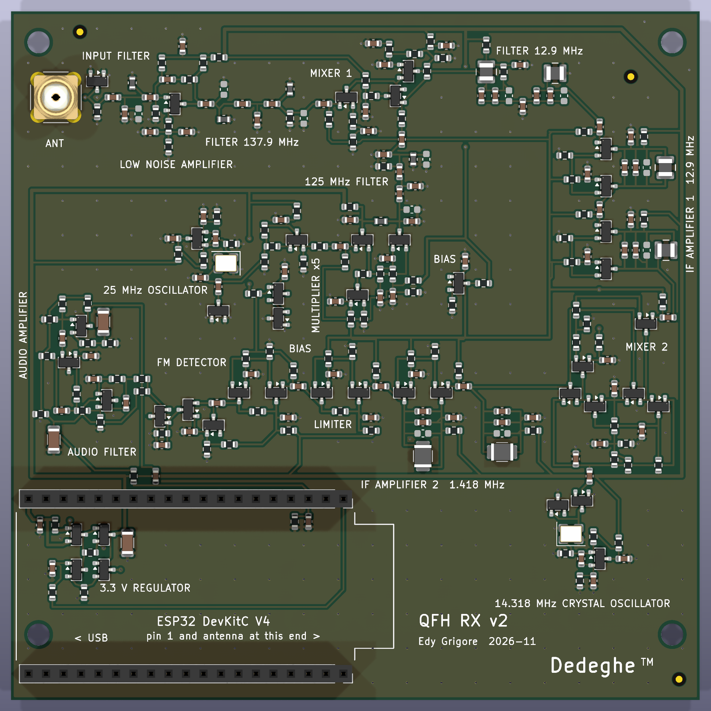
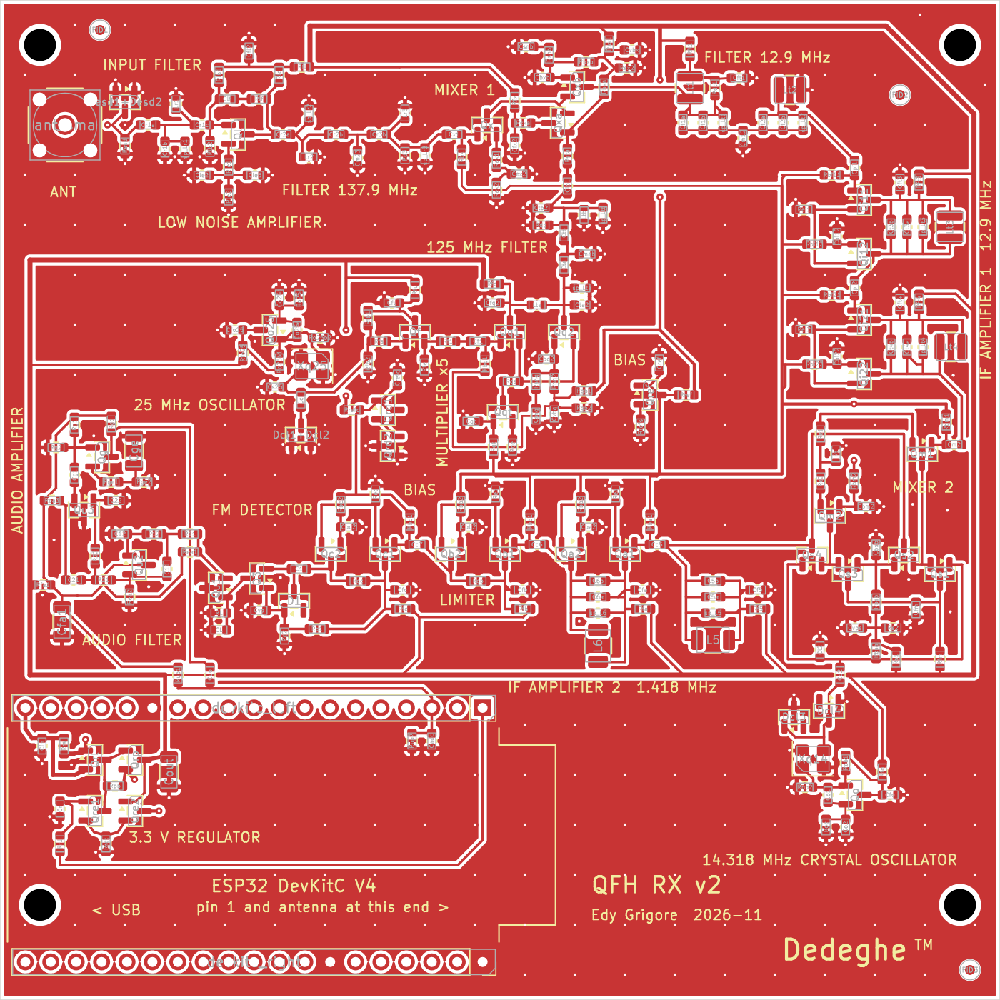
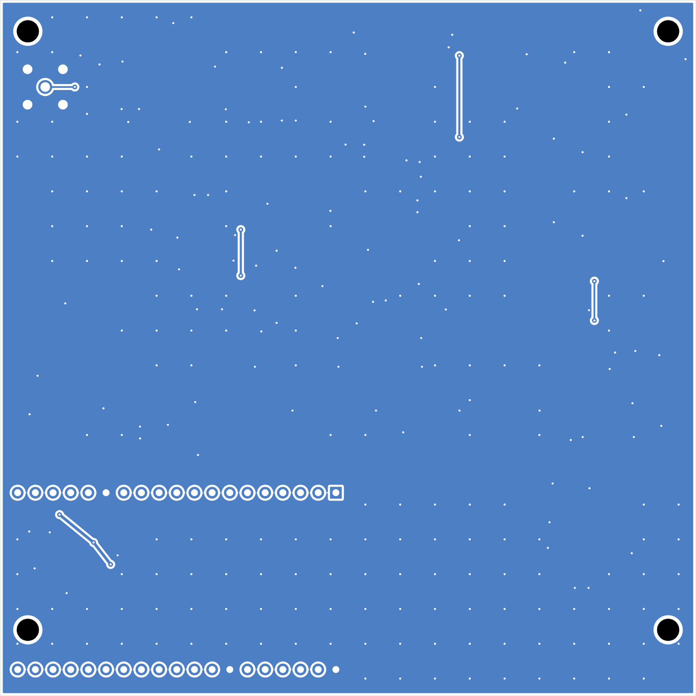
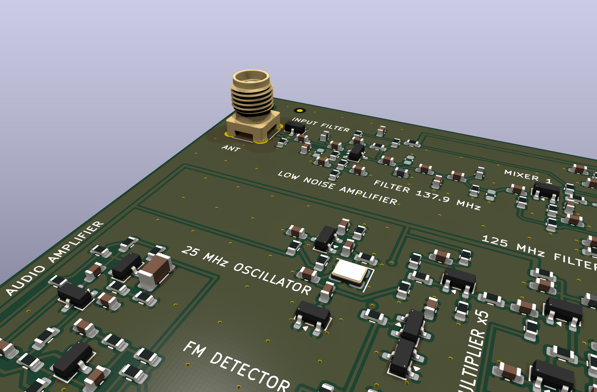

# Schematic and board of receiver version 2

The KiCad 10 schematic of the version 2 receiver. It is not drawn by hand. A
script builds it from the eleven circuit blocks in
[`../fm_receiver_v2/simulations/`](../fm_receiver_v2/simulations) and from the
parts list [`rx2_parts.csv`](../fm_receiver_v2/rx2_parts.csv). A second script
then checks that the result is the simulated circuit. The board is laid out by
scripts as well. It passes KiCad's design rules check and has been checked by
several AI reviewers (see the table). The files for JLCPCB are written.
It was ordered from JLCPCB on 2026-11-16 (5 boards, 2 of them assembled, the
connectors included). The boards have not arrived, and nothing is tested on a
bench.

*KiCad 3D picture of the board, not a photo. It is drawn with the SMA jack and
the two socket rows fitted, which JLCPCB solders by hand; the 11 spare capacitor
positions are empty, and the ESP32 DevKitC is not drawn.*

## State (2026-11-16)

| | |
|---|---|
| Symbols | 266: the 252 parts of the parts list, 3 connectors, 11 spare capacitor positions (not fitted) |
| Electrical rules check (kicad-cli 10.0.3, all severities) | 0 errors, 0 warnings |
| Comparison with the blocks | 0 differences: 578 pins, 117 nodes in the blocks = 117 nets in the schematic |
| Value, footprint, LCSC number | equal to `rx2_parts.csv` for all 252 parts |
| Board | 100 × 100 mm, 2 layers, 273 footprints (the 266 of the schematic, 3 fiducial marks and 4 mounting holes), all on the top side |
| Design rules check of the board (kicad-cli, all severities, with schematic parity) | 0 errors, 0 warnings, 0 open connections, 0 differences to the schematic |
| Copper on the bottom layer | ground, and five short tracks (38.5 mm in all): four hops, and the first 4.25 mm of the antenna track under the SMA jack. None is under the tuned circuits of an IF strip. One (11.7 mm, supply) runs under the track from mixer 1 to the first tuned circuit of the first IF |
| Second check of the board (2026-11-14) | by two AI agents that were not given my reasoning: pin orders against the makers' data sheets, footprints, the DevKitC sockets, the layout rules measured on the board, JLCPCB's limits. No fault found on the board. The check found that JLCPCB needs turned angles for the SOT-23 parts in the placement file; `gen/rx2_fab.py` now writes them |
| Last check before the order (2026-11-15) | by three AI agents, each from one side and none given my reasoning: the circuit and its simulations (both crystal oscillators with the worst crystal the data sheet allows, the chain with the board's strays and the real part values), the parts and pins (their own comparison of the blocks with the board pads: 0 differences on 551 pins), the board and the JLCPCB files (the zip equals a fresh export, their own connectivity test). No fault found. I repeated their key results. The board is still not tested on a bench |
| Third review (2026-11-15) | by three more AI agents: the application and the circuit (the signal through every filter, noise, the signal generator and the ESP32); what gets built (the Gerber and drill files read by the reviewer's own parser: every pad and hole is right, and a netlist taken from those files alone has no short and no open; the footprints against the makers' drawings); the board as hardware (stray capacitances solved numerically from the real copper: each one 70 to 3000 times under its limit, all together a margin of 10 to 30 against the self-lock of the second IF). No fault found. One thing to mind when soldering: the antenna track ran under the metal base of the SMA jack, with only solder mask between (changed afterwards, see the next row) |
| Two changes after the reviews (2026-11-15) | **Mounting holes:** four holes of 3.2 mm for M3 screws, not plated, on a rectangle of 92.0 × 86.0 mm. To make room, the corner of the 3.3 V supply track at the top right became a diagonal, two fiducial marks and one silkscreen text moved, and two ground vias were added. **Antenna track:** it now leaves the SMA jack on the bottom side and comes up through a via beside the jack, so only ground copper lies under the jack's metal base. **Checked afterwards:** a script compared the changed board with the reviewed one, item by item (footprints, pads, tracks, vias, texts, pour outlines, nets): nothing else differs. The rules check is clean again. The new Gerber and drill files were read with the parser of the earlier review: every pad and hole is right, and a netlist taken from the files alone has no short and no open. The AI reviewers have not seen these two changes |
| Files for JLCPCB (`fabrication/`) | Gerber zip (one drill file for the plated holes, one for the four mounting holes), and two pairs of BOM and placement file: the 252 surface-mount parts alone (63 lines), or with the SMA jack and the two DevKitC sockets as well (65 lines, 255 parts). For each part, JLCPCB's own footprint at the written place and angle lands on the board's pads (largest difference 0.30 mm). The first pair is byte for byte the pair that was reviewed |
| Order (2026-11-16) | placed at JLCPCB: 5 boards (green, 1.6 mm, HASL with lead), 2 of them assembled in economic assembly on the top side. Files: the Gerber zip and the second pair (`rx2_receiver_jlc_bom_with_connectors.csv`, `rx2_receiver_jlc_cpl_with_connectors.csv`), so JLCPCB also solders the SMA jack and the two sockets by hand. The uploaded files are byte for byte the ones in `fabrication/`. JLCPCB's order list: $3.63 for the boards and $36.36 for the assembly, without shipping and tax ([`../fm_receiver_v2/COST.md`](../fm_receiver_v2/COST.md)). `fabrication/READ_ME_FIRST.txt` still describes the choice of pair as open |
| JLCPCB's placement preview of the final files | checked for the pair without the connectors: every transistor, diode and crystal with pin 1 on pad 1, the four holes present, no top-side track under the SMA jack. A look at the connectors in the preview of the ordered pair is not recorded; `gen/rx2_fab.py` checks their places against JLCPCB's footprints |

## How to read it

- Open `rx2_receiver.kicad_pro` in KiCad 10, or read `rx2_receiver.pdf`.
- The root sheet shows the eleven blocks and the layout rules. Each block has
  its own sheet, in the order of the signal.
- Parts are not joined by drawn wires. Every pin has a short wire with a net
  name, and pins with the same name are connected. The names are the node
  names of the simulation, so a net can be looked up in the block file.
- Nets that go from one sheet to another have a global label: `m1in`, `osc25`,
  `lo1`, `t1`, `m2in`, `lo2`, `t5`, `det`, `adc`, `vb`, `vbd`. Ground and the
  3.3 V rail are the power symbols `GND` and `VCC`.
- Under each value stands the part's name in the simulation (field `Sim`).
  The other fields are `LCSC`, `MPN` and `Assembly` (JLCPCB, by hand, not
  fitted).
- The comments of the block files and the layout rules for the board are
  printed on the sheets.

## Sheets and reference numbers

A reference is a letter, then the sheet number times 100 plus a running
number in the order of the block file: `R101` is the first resistor of sheet
1, `Q1101` the first transistor of sheet 11.
[`rx2_refs.csv`](rx2_refs.csv) lists every simulation name with its reference.

| Sheet | Block file | Content |
|---|---|---|
| 1 | `rx2_blk_fe.inc` | front end at 137.9 MHz, antenna connector |
| 2 | `rx2_blk_lo1osc.inc` | 25 MHz crystal oscillator |
| 3 | `rx2_blk_lo1mul.inc` | multiplier to 125 MHz |
| 4 | `rx2_blk_mix1.inc` | mixer 1 |
| 5 | `rx2_blk_if1.inc` | first IF, 12.9 MHz |
| 6 | `rx2_blk_lo2.inc` | 14.318 MHz crystal oscillator |
| 7 | `rx2_blk_mix2.inc` | mixer 2 |
| 8 | `rx2_blk_if2.inc` | second IF at 1.418 MHz, limiter, detector |
| 9 | `rx2_blk_audio.inc` | audio chain to the ADC pin |
| 10 | `rx2_blk_reg.inc` | 3.3 V regulator, sockets for the ESP32 DevKitC |
| 11 | `rx2_blk_bias.inc` | the two bias references |

## Part types: symbol, footprint, pins

| Part | KiCad symbol | KiCad footprint | Pins |
|---|---|---|---|
| Resistor 0603 | `Device:R` | `Resistor_SMD:R_0603_1608Metric` | no direction |
| Capacitor 0603 | `Device:C` | `Capacitor_SMD:C_0603_1608Metric` | no direction |
| Capacitor 100 µF, 1206 | `Device:C` | `Capacitor_SMD:C_1206_3216Metric` | no direction |
| Inductor 68 nH, 0603 | `Device:L` | `rx2:L_0603_LQW18A` | no direction |
| Inductor 3.3 µH, 1008 | `Device:L` | `rx2:L_1008_AHW2520C` | no direction |
| Inductor 100 µH, 1210 | `Device:L` | `rx2:L_1210_NLV32` | no direction |
| 2SC3356, S9018, MMBT3904 | `Transistor_BJT:Q_NPN_BEC` | `Package_TO_SOT_SMD:SOT-23` | 1 base, 2 emitter, 3 collector |
| MMBT3906 | `Transistor_BJT:Q_PNP_BEC` | `Package_TO_SOT_SMD:SOT-23` | 1 base, 2 emitter, 3 collector |
| BAS70 | `rx2:D_Schottky_A1_K3` (in `rx2.kicad_sym`) | `Package_TO_SOT_SMD:SOT-23` | 1 anode, 3 cathode, 2 free |
| BAV99 | `Device:D_Dual_Series_AKC` | `Package_TO_SOT_SMD:SOT-23` | 3 to the signal node, 1 and 2 to ground |
| Crystal 3225 | `Device:Crystal_GND24` | `Crystal:Crystal_SMD_3225-4Pin_3.2x2.5mm` | 1 and 3 crystal, 2 and 4 ground |

In the block files a transistor line lists collector, base, emitter. The
generator puts them on pins 3, 1, 2. The footprint `SOT-23` has pads 1 and 2
on one side and pad 3 alone on the other, which is the usual numbering.

## Parts that are not in the simulation

| Part | Reference | State |
|---|---|---|
| Antenna connector, SMA, LCSC C496549 | `J101` | its data sheet shows a vertical through-hole jack (the coax plugs in from above), not an edge type. Footprint `rx2:SMA_BWSMA-KE-Z001_Vertical`: five holes of 1.4 mm, four legs on a 5.08 mm square. Soldered by JLCPCB (the order of 2026-11-16 uses the second pair of order files) |
| Two 1×19 sockets for the DevKitC, LCSC C2932678 | `J1001`, `J1002` | soldered by JLCPCB (second pair of order files). Pins used, copied from the version 1 board: left row (J2) 1 = 3V3, 3 = GPIO36, 14 = GND, 19 = 5V; right row (J3) 1 and 7 = GND. Confirmed in Espressif's pin table. The rows are 25.40 mm apart as on Espressif's drawing; some clone boards are narrower, so check the DevKitC against the sockets when the boards arrive |
| Spare capacitor positions | 11 capacitors with the value `spare` | empty 0603 footprints, marked do-not-populate and left out of the BOM. One per tuned circuit, across the same two nodes as its small tuning capacitor (or across the inductor where there is none) |

Test points are not in the schematic. They are decided with the board.

## What is checked and what is not

**Checked by script** (`gen/rx2_check.py`, which reads the block files with its
own code, not with the generator's):

- every part of the blocks is exactly one symbol, and the other way round;
- every value: the text against the parts list, the number or the type against
  the block file;
- the connections: the nets of the schematic and the nodes of the blocks split
  the 578 pins into the same 117 groups. Before the comparison the layout
  estimates of the blocks (names ending in `_x`) are taken out: an estimated
  capacitor is dropped, an estimated inductor is a short, and a package model
  around a transistor is replaced by the transistor's three pins;
- footprint and LCSC number of every part against the parts list;
- the connectors and the spare positions against a table in the script.

**Checked by KiCad:** the electrical rules check, with no errors and no
warnings.

**Read in the data sheets of the exact LCSC parts** (2026-11-14): S9018
(C41375130), MMBT3904 (C20526) and MMBT3906 (C7420354) have pin 1 base, pin 2
emitter, pin 3 collector, with pin 3 alone on its side of the package. That is
the pad numbering of the `SOT-23` footprint. The 2SC3356, the BAS70, the BAV99
and the crystals were read for the parts list
([`PARTS.md`](../fm_receiver_v2/PARTS.md)).

**Not checked yet:**

- The land patterns of the crystals, the three inductors, the SMA jack and the sockets were read in the
  data sheets. KiCad's inductor footprints did not match, so the three inductors and the SMA jack have
  their own footprints in `rx2.pretty`. Not in the data sheets: the pad diameter for the SMA jack (only
  the hole size is given) and whether the 100 µH inductor is shielded (I treat it as open).
- The board is checked by KiCad's rules, by me in pictures, and by AI agents in three rounds (see the
  table at the top). The mounting holes and the moved antenna track came after those rounds and are
  checked by script only. The board is not checked by another person and not on a bench. The stray
  capacitances on the board are estimates and numerical calculations from the copper, not
  measurements. The coupling limits behind the layout rules come from simulation.
- The drawing shows connections by name only. It was not checked by eye part
  by part; the script check above stands in for that.

## The board

100 × 100 mm, 2 layers, 1.6 mm. Every part is on the top side. The bottom side is
a ground plane with five short tracks on it. [`preview/board_top.png`](preview/board_top.png)
and [`preview/board_bottom.png`](preview/board_bottom.png) show both sides.

**Where the blocks are.** The antenna jack is at the top left. The front end and
mixer 1 run along the top edge. The first IF is a column down the right edge, with
mixer 2 below it. The second IF is a row that runs from mixer 2 to the left, with
the detector at its left end and the audio chain beyond it. The ESP32 DevKitC
plugs in along the bottom edge, USB at the left edge; the regulator sits under
it. The 25 MHz oscillator and the multiplier are in the middle, the second
oscillator at the bottom right.

**Why like this.** The design log has eight layout rules
([`DESIGN_LOG.md`](../fm_receiver_v2/DESIGN_LOG.md), sections "Layout rules that
came out of this" and "Found while laying out the board"). The two that shaped
the board most: the pump driver at the end of the second IF must be far from the
first IF, and far from the first tuned circuit of the second IF. Measured on
the board from copper to copper (`gen/rx2_measure.py`): the pump driver's
output node is 52.6 mm from the nearest tuned node of the first IF and 30.8 mm
from the first tuned node of the second IF. Its emitter and base nodes
are 45 and 47 mm from the first IF, a little under the 50 mm of rule 7. The
emitter node carries a much smaller signal. The base node carries the
limiter's output, but a simulation shows that it does no harm (design log,
"Reviews before the order"). So the two strips form an L with
the mixer in the corner, and the detector is at the far end.

**One copper layer for the signals.** A track never changes to the bottom side
under an IF strip, the front end or the 125 MHz chain. Where two nets have to
cross, a part bridges the track: the track runs between the two pads of a
resistor or capacitor that belongs to the other net. The comments in
`gen/rx2_place.py` and `gen/rx2_route.py` name every such place. Four crossings
go through the bottom side instead, with two vias each: the supply for the
middle of the board (under the link from mixer 1 to the first IF, 11.7 mm), the
supply for the second bias reference (6.6 mm), the bias for one transistor of
mixer 2 (5.7 mm) and the sense node of the regulator (10.3 mm, under the
DevKitC). A fifth piece is the start of the antenna track. The metal base of
the SMA jack sits on the top side, so the track leaves the jack's centre pin
on the bottom side and comes up through a via 0.65 mm beside the jack
(4.25 mm, `gen/rx2_ant.py`). No tuned part is that far left; the rule area
that keeps the bottom side free of tracks under the front end starts at
x = 11 mm, right of the jack.

**Ground.** 93 ground pads of the RF, IF and supply parts have their own via
next to the pad. 187 more vias tie the two ground pours together on a 5 mm
grid. The connector pins go solid into the pours. Tracks cut the top pour into
pieces, and a piece with no connection to ground is not drawn at all, which
leaves bare board. 11 more vias tie the larger of these pieces to the bottom
plane, so that they stay as ground copper. 78 small ones (110 mm² in all) stay
bare: they are too narrow for a via, or they lie next to the emitter node of a
transistor pair in the RF and IF stages, where more ground copper would add
stray capacitance. Two more vias tie the copper in the top right corner,
outside the supply track, to the bottom plane.

**Mounting holes.** Four holes of 3.2 mm for M3 screws, not plated, at
(4.0, 4.5), (96.0, 4.5), (4.0, 90.5) and (96.0, 90.5) mm from the top left
corner: a rectangle of 92.0 × 86.0 mm. The lower two are 9.5 mm above the
bottom edge, because a socket row of the DevKitC runs along that edge. The
lower left hole is under the DevKitC, so that screw goes in before the DevKitC
is plugged in. Within 3.5 mm of each hole centre there is only ground copper,
on both sides, so a metal screw head, washer or standoff touches nothing but
ground. `gen/rx2_holes.py` adds the holes to the finished board. Its header
lists what it moves to make room: the corner of the 3.3 V supply track at the
top right (now a diagonal), two fiducial marks and the text "< USB".

**How it is made.** `rx2_place.py` holds the position of every part, block by
block. `rx2_route.py hand` lays the tracks that follow a rule (emitter links,
tuned-circuit ladders, supply and bias trunks, mixer 2, the regulator).
Freerouting does the remaining short connections on the top side only; its
result is kept in `rx2_receiver_routed.ses`. A new Freerouting run gives a
slightly different result, which has to pass the rules check again.

**Silkscreen.** Each block has its name next to it, along the signal path:
input filter, low noise amplifier, filter 137.9 MHz, mixer 1, 25 MHz
oscillator, multiplier × 5, 125 MHz filter, filter 12.9 MHz, IF amplifier 1,
mixer 2, 14.318 MHz crystal oscillator, IF amplifier 2, limiter, FM detector,
audio filter, audio amplifier, regulator and the two bias references. The
outline of the DevKitC shows which way round it plugs in.

**Not on the board:** test points (the pads of the 0603 parts are large enough
to probe) and part references on the silkscreen (no room for 266 of them: use
`rx2_refs.csv` and the pictures).

**Still to check when the boards arrive:** that my own DevKitC fits the
sockets (the board assumes 25.40 mm between its pin rows). JLCPCB draws the SOT-23 footprints turned against KiCad's,
so the placement file adds 180° to KiCad's angle for the transistors and the
BAV99 diodes and 270° for the BAS70 diodes. `gen/rx2_fab.py` works these
angles out from the pad positions of JLCPCB's footprints
(`gen/jlc_pads.json`) and stops if a part does not land on its pads. JLCPCB's
placement preview of the final files confirms them. (The SMA stays the
vertical jack, decided on 2026-11-14. The order of 2026-11-16 used the pair with
the connectors; see the state table at the top.)

| Top copper | Bottom copper |
|---|---|
|  |  |

*Pictures of the copper, made by `gen/rx2_view.py` from the board file. Left:
the top layer with the ground pour (red) and the block names. Right: the
bottom layer (blue), one ground plane with the five short tracks and the four
mounting holes.*

*KiCad 3D picture, not a photo: the antenna jack, the input filter, the low
noise amplifier and the 25 MHz oscillator. The SMA jack is drawn with a
similar jack from KiCad's library.*

## Run it again

With the Python that comes with KiCad 10 (`bin\python.exe` in the KiCad
folder), in `gen/`:

1. `python rx2_sch.py` writes the project, the sheets, `rx2_refs.csv`, and
   runs the rules check, the netlist export and the PDF export.
2. `python rx2_check.py` compares. Its last line must be `DIFFERENCES: 0`.

If a block file or the parts list changes, run both again. Do not edit the
sheets by hand: the next run overwrites them.

The board, each step in its own run of the same Python, KiCad closed:

1. `python rx2_fp.py` once, for the footprint library `rx2.pretty`.
2. `python rx2_board.py place`, then `python rx2_route.py hand`.
3. `python rx2_route.py auto 8` starts Freerouting (its window opens for half a
   minute). Skip this step to keep the routing in `rx2_receiver.ses`.
4. `python rx2_route.py merge`, `python rx2_board.py drc track_dangling`,
   `python rx2_route.py clean`, `python rx2_route.py finish`,
   `python rx2_route.py pockets`, `python rx2_route.py silk`,
   `python rx2_holes.py` (the mounting holes, once),
   `python rx2_ant.py` (the antenna track under the SMA jack, once), and
   `python rx2_route.py pockets` once more.
5. `python rx2_board.py drc all` must report no errors and no open connections.
6. `python rx2_view.py name x0 y0 x1 y1 [layers] [pixels per mm]` makes a picture.
7. `python rx2_measure.py` prints the distances the layout rules ask for.
8. `python rx2_fab.py` writes the files for JLCPCB into `fabrication/`.

## Files

| File | What it is |
|---|---|
| `rx2_receiver.kicad_pro`, `rx2_receiver.kicad_sch` | the KiCad project and its root sheet |
| `rx2_01_fe.kicad_sch` … `rx2_11_bias.kicad_sch` | one sheet per block |
| `rx2.kicad_sym`, `sym-lib-table` | the one symbol that KiCad's libraries do not have (single diode in SOT-23, pins 1 and 3) |
| `rx2_receiver.pdf` | the schematic as a PDF |
| `rx2_receiver.net`, `erc.json` | the exported netlist and the report of the rules check |
| `rx2_refs.csv` | simulation name → reference, sheet, value, footprint, LCSC number |
| `gen/rx2_sch.py` | the generator |
| `gen/rx2_check.py` | the comparison |
| `gen/kisch.py` | a small KiCad schematic writer, used by the generator |
| `gen/probe_libs.py`, `gen/probe_fp.py` | print the pin numbers and pads of the KiCad symbols and footprints used |
| `rx2_receiver.kicad_pcb` | the board |
| `rx2.pretty`, `fp-lib-table`, `gen/rx2_fp.py` | four footprints with the land patterns of the data sheets, and the script that writes them |
| `gen/rx2_place.py` | where every part sits, block by block |
| `gen/rx2_board.py` | builds the board from the netlist and the placement; rules check; statistics |
| `gen/rx2_route.py`, `gen/frhelp.py` | copper: hand-laid tracks, Freerouting, ground vias, pours, silkscreen |
| `gen/rx2_holes.py` | adds the four mounting holes to the finished board |
| `gen/rx2_ant.py` | moves the antenna track under the SMA jack to the bottom side |
| `gen/rx2_view.py`, `preview/` | pictures of the board. `preview/render_*.png` are 3D pictures from `kicad-cli pcb render`: top, bottom, two angled views and a close-up of the front end. They show the board with the connectors soldered and the 11 spare positions empty; the SMA jack is drawn with a similar jack from KiCad's library, and the DevKitC is not drawn |
| `gen/rx2_measure.py` | measures the distances the layout rules ask for and lists the tracks on the bottom layer |
| `fabrication/` | the files for JLCPCB: Gerber zip, two pairs of BOM and placement file (without and with the connectors), and a note with the order settings |
| `gen/rx2_fab.py`, `gen/jlc_pads.json` | write `fabrication/`. The second file holds the pad positions of JLCPCB's own footprints (from EasyEDA's public part data); the places and angles in the placement file are worked out from it and checked. The script also counts the holes in the drill files against the board |
| `rx2_receiver.ses`, `rx2_receiver_routed.ses`, `gnd_vias.json`, `drc.json` | routing result, plan of the ground vias, last rules-check report |

How version 2 was made and who did what:
[`../fm_receiver_v2/README.md`](../fm_receiver_v2/README.md).

Edy Grigore
